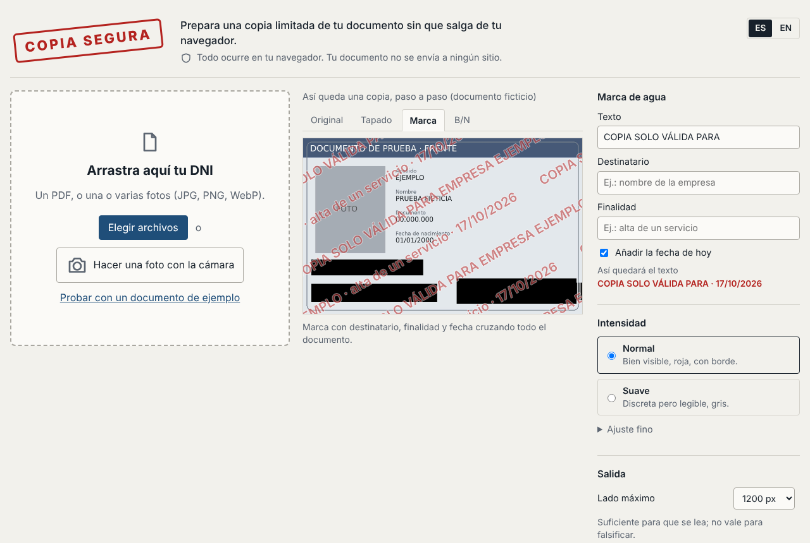
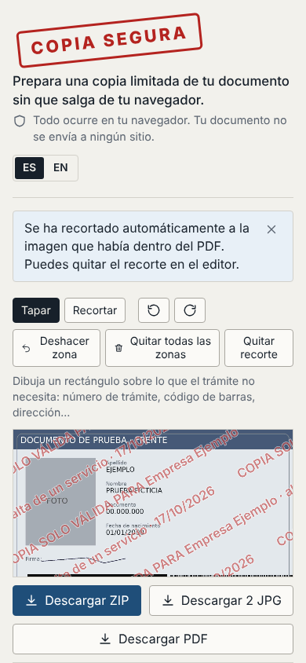

# copia segura

[](https://github.com/hbonavota/copia-segura/actions/workflows/ci.yml)
[](https://hbonavota.github.io/copia-segura/)
[](LICENSE)

**Prepare a limited copy of your ID document without it ever leaving your browser.** Watermark
with recipient, purpose and date; redacted areas; reduced resolution; no metadata. No server, no
account, nothing to install.

[Versión en español](README.md) · [Try it](https://hbonavota.github.io/copia-segura/) · [How it is built](docs/arquitectura.md)



## Why

Every time a company asks for "a photo of your ID" (account ownership change, sign-up, identity
check, a rental…) you hand over a complete, reusable copy of your identity, photo metadata
included. If that copy leaks, there is no way to prove who you gave it to or what for.

Data protection authorities recommend handing over **limited copies**: with a mark stating who, what
for and when; with the data the process does not need covered; and at just enough resolution. Doing
that by hand is tedious, and "add a watermark" websites ask you to upload the document to someone
else's server, which is exactly what you want to avoid.

## What it does

|               |                                                                                                                                                                                                                                                                                |
| ------------- | ------------------------------------------------------------------------------------------------------------------------------------------------------------------------------------------------------------------------------------------------------------------------------ |
| **Input**     | A PDF (every page is editable; if a page is an A4 with the document photo inside, it is cropped automatically), JPG/PNG/WebP photos, or a camera capture for the "holding the document" selfie (not mirrored).                                                                 |
| **Editing**   | Redact areas by drawing with mouse or finger, by strips with buttons, or with templates of typical areas (Spanish and Argentine IDs, front and back); crop, rotate, undo.                                                                                                      |
| **Watermark** | Editable text: `COPY ONLY VALID FOR <recipient> · <purpose> · <date>` (Spanish default in the Spanish UI). Two intensities (_Normal_ and _Subtle_) plus fine tuning of opacity, size, spacing, angle, colour and outline. The tiling covers the whole image, corners included. |
| **Output**    | One JPG per page, a ZIP, a multi-page PDF, or the phone's share menu. Optional black and white. Configurable longest side (1200 px by default); no EXIF, XMP or colour profile from the original photo.                                                                        |
| **Privacy**   | Everything happens in the browser. The page cannot make requests to other domains (enforced by its Content Security Policy) and stores the document nowhere. An end-to-end test records every request of a full flow and fails if any leaves the origin.                       |

And what it does **not** do, stated in the interface itself: a watermark deters and leaves a trace,
but it does not stop someone from using the copy, and it can be attacked with inpainting tools.
Details in the [threat model](docs/amenazas.md) (Spanish).

<p align="center"></p>

## What makes it different

Other sites also promise to process your document "locally". The difference is that here you do
not have to take our word for it:

|                                         | copia segura                                                                                                                                                                                                            |
| --------------------------------------- | ----------------------------------------------------------------------------------------------------------------------------------------------------------------------------------------------------------------------- |
| **No third parties**                    | No analytics, no Google Fonts, no CDN. The page only talks to the server that hosts it (GitHub Pages), and only to load itself; the document never leaves the browser.                                                  |
| **Verifiable, not promised**            | A Content Security Policy stops the page from fetching data or loading resources from other domains (also inside the worker that parses the PDF), and an end-to-end test checks it on every change. The code is public. |
| **PDFs and multiple pages**             | Open the PDF from your scanner or phone, crop the card inside it automatically, and export front and back together as PDF or ZIP.                                                                                       |
| **No metadata, just enough resolution** | Removes location, phone model and date from the photo; caps the size so it is good for reading, not forging.                                                                                                            |
| **Typical areas in one click**          | Templates for Spanish and Argentine IDs (front and back).                                                                                                                                                               |
| **Black and white**                     | The document in greyscale, the watermark in colour.                                                                                                                                                                     |
| **Honest about its limits**             | It explains what a watermark achieves and what it does not, instead of promising security that does not exist.                                                                                                          |

The app itself has a **Check it yourself** section with three steps to verify this without reading
code: the Network tab of the developer tools, the security policy in the page source, and the test
that enforces it.

## Use it

The simplest way is the [published version](https://hbonavota.github.io/copia-segura/): nothing to
install. With photos it keeps working offline once loaded; opening a PDF or exporting to PDF/ZIP
downloads the corresponding modules the first time, always from the page's own origin.

Locally, with Node 22.13 or newer (`.nvmrc`):

```bash
git clone https://github.com/hbonavota/copia-segura.git
cd copia-segura
npm install
npm start          # opens http://localhost:5173
```

`npm start` only serves static files: there is no backend, not even in development.

## How it is built

The project doubles as a sample of a way of working: **Spec-Driven Development** and **clean
architecture** applied to a genuinely small application.

- **Specification first.** `docs/specs/` holds the vision, the functional requirements (`RF-xx`)
  with _Given / When / Then_ acceptance criteria, the non-functional ones (`RNF-xx`) and the domain
  model. Tests cite the requirement they cover (`describe('RF-07 · marca de agua')`), so any line of
  code can be traced back to the reason it exists.
- **Decisions on record.** `docs/adr/` explains why there is no backend, why there is no UI
  framework, why pdf.js and pdf-lib, and what the CSP guarantees.
- **Four layers with one-way dependencies**, enforced by a test:

  ```
  ui  →  application  →  domain          infrastructure implements application's ports
  ```

  `domain/` is pure (watermark geometry, rectangle rotation, embedded-image detection from a PDF
  operator list) and is tested without a browser. `application/` holds use cases and ports.
  `infrastructure/` holds the adapters (pdf.js, canvas, pdf-lib, JSZip, `getUserMedia`). `ui/` is
  TypeScript against the DOM, no React: a minimal observable state store and views that mount and unmount.

- **Three levels of testing.** Unit tests for `domain` and `application` with port doubles (Vitest,
  ≥ 90 % line and ≥ 85 % branch coverage); an architecture test that analyses imports; and Playwright end-to-end tests
  against the production build, CSP included.
- **CI and deployment.** Every push runs lint, typecheck, formatting, tests, build and e2e. `main`
  is published to GitHub Pages only when CI is green.

More detail and a diagram in [`docs/arquitectura.md`](docs/arquitectura.md). The documentation is
written in Spanish, the language of the audience the tool is for; the code, identifiers and commit
messages are in English where the ecosystem expects it and Spanish where the domain does.

### Structure

```
docs/
  specs/          SPEC-0001…0005: vision, requirements, NFRs, domain model, landing and differentiators
  adr/            architecture decision records
  arquitectura.md layers, ports, one use case end to end
  amenazas.md     threat model: what it protects and what it does not
src/
  domain/         pure types and functions
  application/    use cases and ports
  infrastructure/ browser adapters
  ui/             views, store, i18n, styles, main.ts (composition root)
tests/            unit and architecture tests (Vitest)
e2e/              Playwright
scripts/          pdf.js assets, sample document, screenshots
```

### Commands

| Command                 | What it does                                                                                     |
| ----------------------- | ------------------------------------------------------------------------------------------------ |
| `npm start`             | Dev server, opens the browser                                                                    |
| `npm test`              | Unit and architecture tests                                                                      |
| `npm run test:e2e`      | End-to-end tests against the production build (`npx playwright install chromium` the first time) |
| `npm run check`         | Lint, typecheck, formatting, tests and build: same as CI                                         |
| `npm run build`         | Production build in `dist/` (`BASE_PATH=/copia-segura/` for Pages)                               |
| `npm run example:build` | Regenerates the sample PDF from the fictional cards                                              |

## Contributing

Changes start from the requirement: if the change alters the scope, a new spec in `docs/specs/`
comes first; otherwise, a PR with its test. See [CONTRIBUTING.md](CONTRIBUTING.md). Vulnerabilities
are reported as described in [SECURITY.md](SECURITY.md).

## License

[MIT](LICENSE) · Hernán Bonavota
