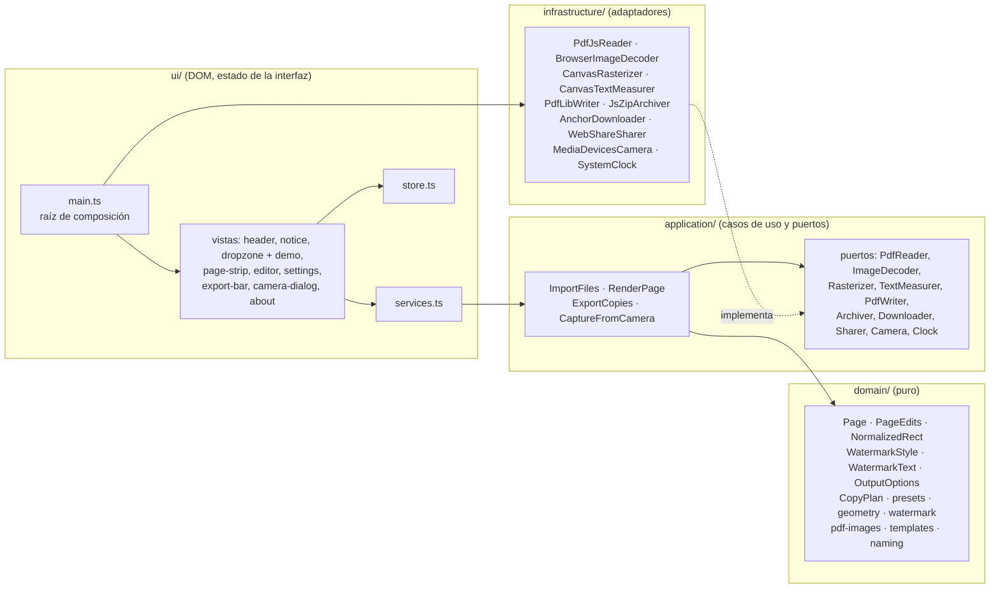

# Arquitectura

copia-segura es una aplicación de una sola página sin backend. El código se organiza en cuatro capas
con dependencias en un solo sentido (ADR-0002). Esta página describe qué hay en cada una y cómo
atraviesa un caso de uso el sistema.

## Capas

### `src/domain/`

Funciones puras y tipos. Sin imports externos a la carpeta, sin DOM, sin `Date.now()`.

| Módulo          | Responsabilidad                                                                                                                            |
| --------------- | ------------------------------------------------------------------------------------------------------------------------------------------ |
| `types.ts`      | `Page`, `PageEdits`, `Rotation`, `NormalizedRect`, `WatermarkStyle`, `WatermarkText`, `OutputOptions`, `CopyPlan`.                         |
| `geometry.ts`   | Normalizar rectángulos, girarlos con la página, intersectar con el recorte, escalar a píxeles, `fitScale`.                                 |
| `presets.ts`    | Presets _Normal_ y _Suave_; `resolveStyle(preset, overrides)`; acotación de rangos.                                                        |
| `watermark.ts`  | Composición del texto (`composeWatermarkText`) y cálculo del mosaico (`layoutWatermark`), que recibe una función `MeasureText` para medir. |
| `plan.ts`       | `planCopy(...)`: combina todo lo anterior en un `CopyPlan` determinista.                                                                   |
| `pdf-images.ts` | Reconstrucción de la matriz de transformación sobre la lista de operadores de un PDF para localizar imágenes incrustadas.                  |
| `templates.ts`  | Plantillas de zonas a tapar por tipo de documento, relativas a la tarjeta (RF-16).                                                         |
| `naming.ts`     | Nombres de archivo de salida.                                                                                                              |

### `src/application/`

Casos de uso (una función o clase pequeña por caso) y puertos (interfaces TypeScript). Solo importa
`domain`.

- `ImportFiles`: decide por extensión/`type` si un archivo es PDF o imagen, usa `PdfReader` o
  `ImageDecoder` y devuelve `Page[]` con etiquetas únicas. Propone recorte automático para páginas
  de PDF con una imagen grande.
- `RenderPage`: `planCopy` + `Rasterizer.render(plan)` → `{ raster, plan }`. Lo usan la vista previa,
  la demo de la portada y la exportación, así que las tres ven exactamente lo mismo.
- `ExportCopies`: renderiza cada página, codifica a JPEG con la calidad del plan y entrega JPG, ZIP,
  PDF o los pasa al menú de compartir (`share`). Desambigua nombres repetidos.
- `CaptureFromCamera`: abre la cámara, captura un fotograma sin espejo, cierra la cámara.

### `src/infrastructure/`

Un archivo por adaptador. Es la única capa que conoce pdf.js, canvas, pdf-lib, JSZip, `getUserMedia`
o el DOM de descarga. Cada adaptador implementa exactamente un puerto.

### `src/ui/`

- `main.ts`: raíz de composición. Construye los adaptadores, los casos de uso y monta las vistas.
- `store.ts`: estado inmutable con `get`, `update` y `select` (suscripción por selector), más las
  acciones que lo transforman.
- `services.ts`: orquesta casos de uso con el estado (ocupado, avisos traducidos).
- `views/*.ts`: cada vista recibe el elemento raíz, el store y las dependencias que necesita.
- `theme.ts`: tema claro / oscuro (RF-19). La decisión es una función pura (`toggledPreference`,
  probada sin navegador); aplicar y recordar, en funciones finas sobre el DOM. `public/theme.js`
  aplica la preferencia guardada antes del primer pintado.
- `i18n/`: diccionarios `es` y `en`.
- `styles.css`: tokens de diseño (cada color, un par `light-dark()`) y estilos. Sin preprocesador.

## Un caso de uso de principio a fin: exportar un PDF

1. La vista `export-bar` llama a `services.exportAs('pdf')`, que marca la interfaz como ocupada y
   llama a `ExportCopies.run({ format: 'pdf' })` con las páginas del store.
2. `ExportCopies` recorre las páginas; para cada una llama a `planCopy` (dominio) con la página, sus
   ediciones, el estilo y texto de la marca y las opciones de salida. Para medir el texto, el dominio
   recibe la función del puerto `TextMeasurer`.
3. El `CopyPlan` resultante (tamaño de salida, giro, recorte, máscaras en píxeles, posiciones del
   mosaico) se pasa a `Rasterizer.render`, que lo ejecuta sobre un canvas nuevo.
4. El canvas se codifica a JPEG con la calidad del plan. `PdfWriter.write(jpegs)` construye el PDF con
   una página por imagen y `Downloader.download(blob, name)` lo entrega al usuario.
5. Nada de esto toca red ni almacenamiento: todo son `Blob` en memoria que se liberan al terminar.

## Pruebas

| Nivel        | Qué cubre                                                                                                                                                                                                                                             | Herramienta                  |
| ------------ | ----------------------------------------------------------------------------------------------------------------------------------------------------------------------------------------------------------------------------------------------------- | ---------------------------- |
| Unitarias    | `domain` y `application` con puertos falsos, y la lógica pura del tema. Nombradas por requisito (`RF-07`).                                                                                                                                            | Vitest, entorno Node         |
| Arquitectura | Regla de dependencia entre capas.                                                                                                                                                                                                                     | Vitest (análisis de imports) |
| E2E          | Flujo completo con el documento de ejemplo en Chromium, servido bajo `/copia-segura/` como en Pages: importar, tapar, exportar, portada, plantillas, B/N, móvil, **cero peticiones externas** y una petición a otro dominio **bloqueada por la CSP**. | Playwright                   |
